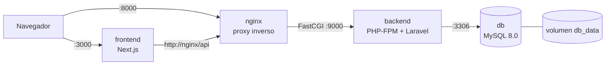

# 🐳 E-commerce Dockerizado: Next.js + Laravel + MySQL

Actividad evaluada del bootcamp Kodigo: **Ingeniería de Imágenes Eficientes, Refactorización Multi-stage y Optimización de Capas en Docker**.

## 📌 Descripción general

Ecosistema de tres servicios, desarrollados durante el bootcamp, preparado para producción con imágenes ligeras, seguras y reproducibles:

- **Frontend**: tienda en Next.js 16 (App Router)
- **Backend**: API REST en Laravel con PHP 8.4 (JWT, Swagger, Stripe)
- **Base de datos**: MySQL 8.0

Todo se levanta con un solo comando mediante `docker-compose.yml`.

## 🏗️ Arquitectura de contenedores



| Servicio | Imagen base | Puerto en el host |
|----------|-------------|-------------------|
| frontend | `node:20-alpine` | 3000 |
| nginx | `nginx:alpine` | 8000 |
| backend | `php:8.4-fpm-alpine` | no expuesto (9000 interno) |
| db | `mysql:8.0` | no expuesto (3306 interno) |

## 📁 Estructura del repositorio

```
ecommerce-docker/
├── backend/            # API Laravel + Dockerfile
├── frontend/           # Next.js + Dockerfile
├── nginx/default.conf  # Configuración del proxy inverso
├── docker-compose.yml
├── .env.example
└── README.md
```

## 🚀 Cómo ejecutarlo

**Requisitos:** Docker Desktop con Docker Compose.

1. Clona el repositorio:
   ```bash
   git clone https://github.com/carlospineda2011-beep/NOMBRE-DEL-REPO.git
   cd NOMBRE-DEL-REPO
   ```
2. Crea tu archivo de entorno y completa los valores:
   ```bash
   cp .env.example .env
   ```
   Genera `APP_KEY` y `JWT_SECRET` (ver sección de variables).
3. Levanta todo el ecosistema:
   ```bash
   docker compose up --build
   ```
4. En otra terminal, crea las tablas y los datos de prueba:
   ```bash
   docker compose exec backend php artisan migrate --seed
   ```
5. Abre:
   - Frontend: http://localhost:3000
   - API: http://localhost:8000/api/products
   - Swagger: http://localhost:8000/api/documentation

Para detener todo: `docker compose down` (agrega `-v` para borrar también los datos de MySQL).

## 🔐 Variables de entorno

Documentadas en `.env.example`:

| Variable | Descripción |
|----------|-------------|
| `MYSQL_ROOT_PASSWORD` | Contraseña de root de MySQL |
| `MYSQL_DATABASE` | Nombre de la base de datos |
| `MYSQL_USER` / `MYSQL_PASSWORD` | Usuario de la aplicación |
| `APP_KEY` | Clave de Laravel (`php artisan key:generate --show`) |
| `JWT_SECRET` | Secreto de JWT (`php artisan jwt:secret --show`) |
| `API_BASE_URL` | URL interna de la API vista desde el frontend (`http://nginx/api`) |

> El archivo `.env` real está en `.gitignore` y nunca se sube al repositorio.

## 🧠 Decisiones técnicas

### Backend (`backend/Dockerfile`)
- **Multi-stage en 2 etapas.** Una etapa con `composer:2` instala dependencias; la imagen final solo copia la carpeta `vendor/`, sin Composer ni herramientas de build.
- **Caché de capas.** Se copian `composer.json` y `composer.lock` antes que el código, para que las dependencias no se reinstalen cuando solo cambia el código.
- **`--no-dev` y `--optimize-autoloader`.** Sin dependencias de desarrollo y con autoload optimizado.
- **`php:8.4-fpm-alpine`.** Imagen mínima. Se usó PHP 8.4 porque las dependencias de Composer lo exigen (el enunciado pide 8.2+).
- **Extensiones PHP.** Se revisaron con `php -m` y solo se instaló `pdo_mysql`; el resto ya viene en la imagen.
- **`.dockerignore`.** Excluye `vendor`, `.env`, logs y cachés de `bootstrap/cache`, para que cachés locales con paquetes de desarrollo no contaminen la imagen.
- **Seeder sin factories.** Faker es una dependencia de desarrollo y no existe en la imagen de producción.

### Frontend (`frontend/Dockerfile`)
- **Multi-stage en 3 etapas:** `deps` (`npm ci`), `builder` (`next build`) y `runner` (solo lo necesario para `next start`).
- **`npm ci`** para instalaciones reproducibles a partir del `package-lock.json`.
- **`node:20-alpine`** como imagen base, ligera.
- **Páginas dinámicas.** Las páginas que consumen la API se renderizan en cada petición (`force-dynamic`), porque la API no existe en tiempo de build. Por eso se desactivó `cacheComponents` en la configuración de Next.js.
- **`API_BASE_URL` como variable de runtime**, no de build, apuntando al servicio `nginx` por la red interna de Docker (dentro del contenedor, `localhost` sería él mismo).

### Nginx
- Actúa como **proxy inverso** de PHP-FPM: recibe HTTP en el puerto 80 y entrega los `.php` al backend por FastCGI en el puerto 9000.

### MySQL
- Imagen oficial `mysql:8.0`, configurada solo con variables de entorno.
- **Volumen persistente** `db_data` en `/var/lib/mysql`.
- **Healthcheck:** el backend espera a que la base de datos esté lista (`service_healthy`).
- **El puerto 3306 no se expone al host**, solo es accesible dentro de la red de Docker.

## 🛠️ Tecnologías

Next.js 16 · Laravel · PHP 8.4 · MySQL 8.0 · Nginx · Docker · Docker Compose

## 👤 Autor

Carlos Alfredo Peña Pineda